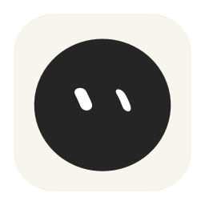

<p align="center"></p>

# Vela

**Keeping watch. Keeping you connected.**  
替你值守，随时相连。

[English](README.md)

Vela 是一个原生 macOS 桌面伙伴，集保持唤醒、本机 Agent 自动值守与远程桌面于一体。你可以和桌面上的小家伙互动，也可以离开电脑，让它保持工作运行，并从其他设备接回桌面。

## 功能

- **桌面陪伴：** 拖动定位、多种形体、眼睛与表情动画、自动表情、独立唤醒／静息配色、渐变和实时 Metal 特效。隐藏桌宠不会停止其他功能。
- **保持运行：** 保持显示器唤醒、允许屏幕休眠但系统继续运行，或合盖后继续运行。支持无限时长、自定义时长，以及真实键鼠空闲后开始并在操作时重置的倒计时。
- **Agent 值守：** 检测 Claude Code、Codex、Gemini CLI、Cursor Agent、Copilot CLI、Aider、OpenCode 和自定义可执行文件名。可选“仅工作中的 Agent”或“进程存在即保活”，并提供静默宽限、低电量与过热保护。
- **远程桌面：** 使用支持 WebRTC 的浏览器或内置的 **Vela Connect** Mac 控制端连接；支持显示器与画质选择、键鼠操作、文本发送、触控模式和桌面切换手势。
- **虚拟显示器：** 创建自定义分辨率与 HiDPI 的远程屏幕。可在虚拟屏工作时关闭物理显示器，本机输入、断线和恢复机制负责恢复物理屏。
- **原生设置：** 通用、唤醒、值守、外观、远程五个页面，采用紧凑分组、Liquid Glass 导航工具栏和原生开关、滑块，支持浅色、深色、自动三种外观，自动模式跟随系统，并尊重辅助功能偏好。
- **中英双语：** 无论系统语言如何，首次默认使用英文。在主应用 **Settings → General → Language**（中文界面为“通用 → 语言”）、Vela Connect 工具栏或网页语言选择器中切换简体中文。各端独立保存选择，切换语言不重启远控会话。

## 环境要求

- macOS 26 或更高版本，以及 Swift 6 工具链／Xcode 命令行工具。
- 首次解析固定版本的 Swift Package Manager 依赖需要网络。
- 可使用的应用包需要固定代码签名证书。构建脚本优先读取 `SIGNING_IDENTITY`，其次读取 `.signing-identity.local`；不会回退到临时签名。
- 网页单元测试需要 Node.js；翻译检查与浏览器模拟服务需要 Python 3。

## 构建和运行

```sh
swift package resolve
./scripts/build-app.sh release Vela
open dist/Vela.app
```

应用包内包含原生控制端：

```text
Vela.app/Contents/Applications/VelaConnect.app
```

也可从 **设置 → 远程 → 原生控制端…**（英文为 **Open Vela Connect…**） 打开。打包脚本会签署并验证主应用、控制端及其 WebRTC framework，不执行 Apple 公证，也不自动替换 `/Applications` 中已安装的版本。

仅编译或检查未签名包结构：

```sh
swift build -c debug
./scripts/build-app.sh release Vela --offline-check
```

未签名结构检查包位于 `.build/offline-bundle/Vela.app`。可用 `VELA_OUTPUT_DIR` 指定签名构建的输出目录。

## 日常使用

Vela 启动时保持唤醒关闭，桌宠显示。通过菜单栏或悬停桌宠后出现的按钮，控制保持唤醒、Agent 值守、保持方式和设置。默认全局快捷键为 **Control + Option + Command + K**。

手动保活与 Agent 值守共用保持方式。“仅工作中的 Agent”通过 `caffeinate` 子进程或约 60 秒的 CPU 活动判断；低 CPU 的网络等待可选择“进程存在即保活”。检测仅针对当前用户的本机进程，不能看到远端或容器内进程。

设置包含时长、空闲阈值、Agent 静默宽限、低电量阈值、自定义 Agent、登录启动、外观与语言。重新启动时不会自动恢复手动保持唤醒；明确开启的远控会随应用启动恢复。

合盖值守会请求管理员授权，临时管理 `pmset disablesleep`。临时监视进程在正常停止、应用退出或心跳异常后恢复原设置。它不是常驻系统服务，无法在系统重启后、登录前继续恢复。如果合盖值守期间发生重启或断电，开机后应检查 `pmset -g`，必要时使用 `sudo pmset -a disablesleep 0` 恢复。

## 远程连接

1. 在 **设置 → 远程** 中选择“自定义密码”或当前“macOS 系统账户”，再明确开启远控。自定义密码至少 10 个字符。
2. 在被控 Mac 为 Vela 授予 **屏幕录制**和**设备控制和数据访问**权限（macOS 26 中称为“辅助功能”），入口位于 **设置 → 远程**。**输入监控**权限单独在 **设置 → 唤醒** 中管理。如系统请求本地网络权限，也需要允许；按系统提示退出并重新打开应用。
3. 使用设置页显示的实际地址，通常为 `https://IP:8443`。监听范围可选仅局域网或所有 IPv4 接口；后者包含可达的 VPN 接口。`0.0.0.0` 是监听地址，不能用作远端连接目标。
4. Vela Connect 首次连接时核对主机证书的 SHA-256 指纹。使用浏览器时，先导出公开证书，通过可信方式传送、核对并导入控制设备的信任库，再输入密码。不要复制私钥。
5. 连接后选择显示器，按需使用屏幕键盘和鼠标工具。一次仅允许一个控制者。修改认证方式或访问密码会撤销已有会话。

系统账户模式仅接受运行 Vela 的本机账户，密码交给 macOS 验证且不保存。不支持 Touch ID 或 Apple ID 密码。普通锁屏时，远控显示真正的 macOS 锁屏画面，可点击系统密码框并输入 Mac 密码解锁；不覆盖 FileVault 或开机首次登录前的阶段。

远控要求通过局域网或 VPN 直接可达，不自动配置路由器转发、云中继、公共 STUN 或 TURN。HTTPS 提供网页与信令；WebRTC 协商媒体端口，优先使用 UDP。

## 虚拟屏与物理屏

在网页 **显示** 面板创建并选择虚拟屏。总像素上限为 3840 × 2160，支持竖屏。HiDPI 下每个方向的逻辑尺寸为像素尺寸的一半；实际接收尺寸以 **画质** 面板为准。

确认虚拟屏画面正常后，在 **物理屏** 面板关闭 Mac 内屏和外接物理显示器。远程输入继续在虚拟屏工作；本机键盘、鼠标、触控板或“恢复所有物理屏”按钮可以恢复。断线时先恢复物理屏，再关闭虚拟屏。

关闭物理屏不等于密码锁定。真正的系统锁屏会恢复物理屏，并切换采集到系统锁屏画面；解锁后返回先前选择的桌面屏幕。显示器管理依赖运行时检测的私有接口，macOS 更新可能影响其可用性；显示拓扑变化时的窗口移动由 macOS 管理。

## 开发与检查

```sh
swift test
node --test Tests/WebClient/*.test.cjs
python3 scripts/check-localization.py
.build/debug/Vela --watch-policy-test
.build/debug/Vela --self-test
```

原生自检会短暂创建真实电源断言与测试窗口，并在结束后释放，使用隔离的偏好和远控设置。实时 Metal 检查需要可见桌面；窗口被遮挡时，会明确报告未能判定。

无需改变真实桌面状态的浏览器模拟测试：

```sh
python3 Tests/WebClient/mock-server.py --port 8769
```

在全新浏览器上下文打开 `http://127.0.0.1:8769`，分别加载 `/language-tests.js`、`/session-tests.js`、`/touch-tests.js`，调用 `runLocalizationChecks()`、`runPrivateSessionChecks()`、`runTouchChecks()`。语言检查应在全新页面首先运行。这些模拟会替换 WebRTC 与 API 调用，不会控制真实 Mac。

英文 [AGENTS.md](AGENTS.md) 说明架构、翻译约定和开发流程；[TESTING.txt](TESTING.txt) 说明额外测试与现场操作边界。

## 兼容性与当前限制

- Vela 保留原有 `app.aiomni.awakepet` 和 `app.aiomni.awakepet.remoteviewer` bundle ID，以维持签名身份和系统权限。应使用同一签名证书；改变安装路径仍可能触发系统重新批准。
- 已有 `~/Library/Application Support/AwakePet/RemoteControl` 数据会原地复用，包括证书和运行锁。全新安装使用 `~/Library/Application Support/Vela/RemoteControl`。更名本身不会重置密码或重新生成证书。
- 尚不包含音频、文件传输、剪贴板同步、云中继或登录前访问。远控本身不阻止合盖睡眠。
- 保留原有桌宠造型、全部表情与动画序列。运行 `python3 scripts/check-companion.py` 可检查资源完整性。素材来源及上游使用限制记录在应用包随附的 [ThirdPartyNotices.txt](Resources/ThirdPartyNotices.txt) 中；Vela 不会为这些素材重新授权。
- `Design/` 中的旧文档保留历史开发与验收记录，可能出现旧产品名与已被替代的行为描述。
